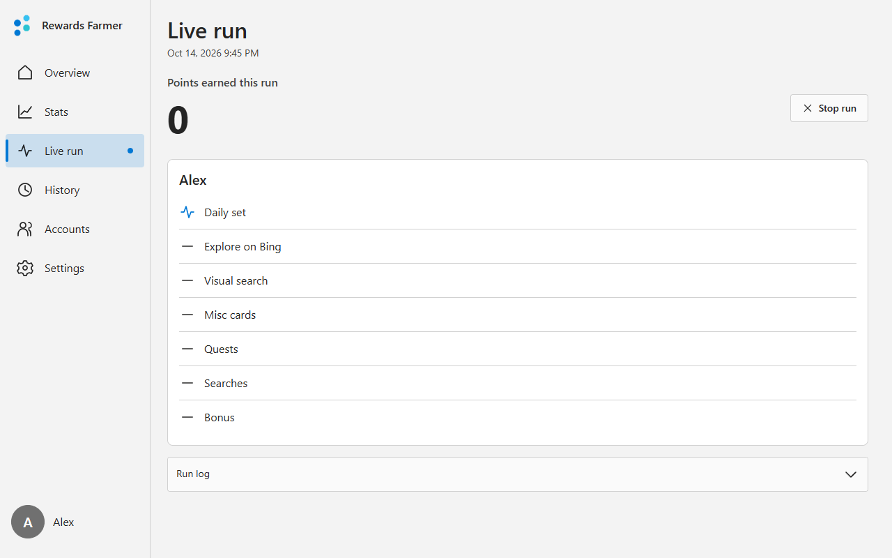
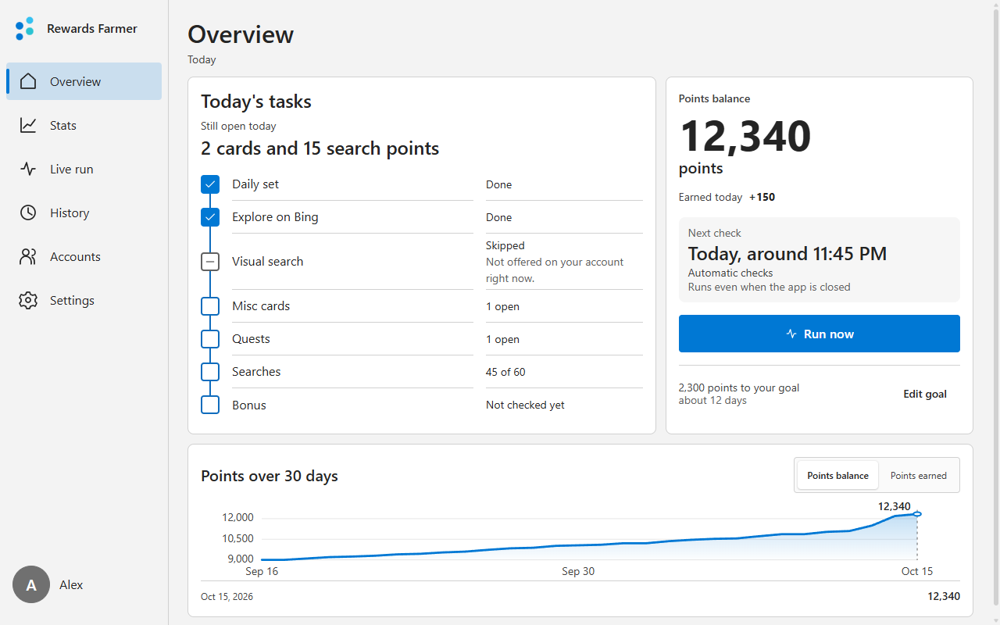
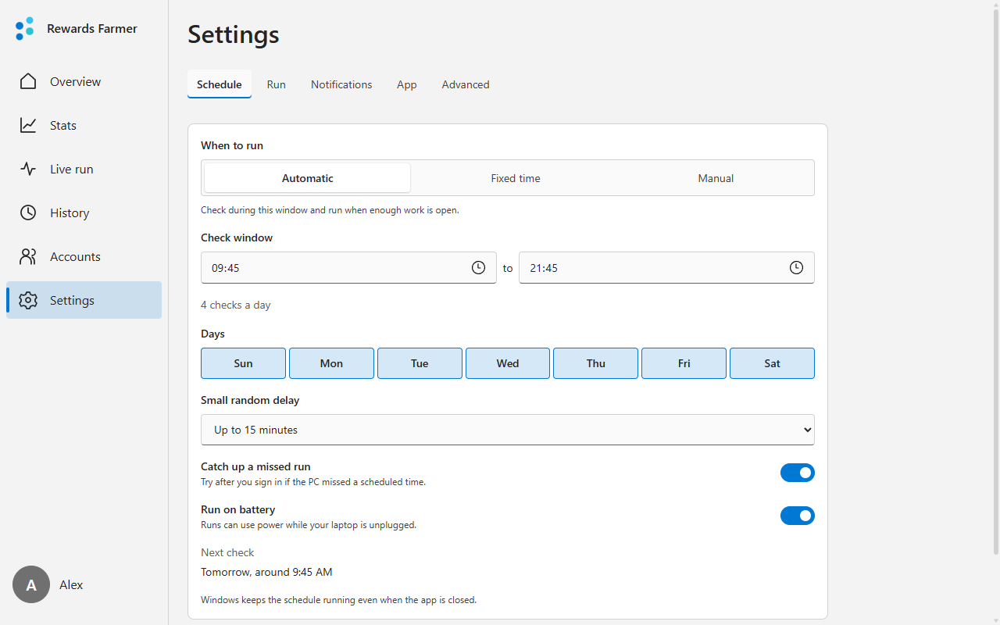

# Rewards Farmer for Windows



A desktop app that collects your Microsoft Rewards points. It looks at your Rewards page a few times a day and only starts when points are left, then does the searches, the daily set and the other tasks in its own Edge window. You see your balance, what each run did and how your points add up

Underneath it runs [User0332/rewards-farmer](https://github.com/User0332/rewards-farmer). MIT licensed like the original

> [!WARNING]
> Microsoft's Rewards terms dont allow bots or other automated ways to earn points, and Microsoft can close an account and take its points over it. Only use this if youre fine with that risk for your own account

## Install

You need Windows 10 or 11 (64-bit) and Microsoft Edge

1. Download `RewardsFarmer-0.1.0-windows-x64-Setup.exe` from the [latest release](https://github.com/mardausdennis/rewards-farmer-app/releases/latest)
2. Run it. It installs for your Windows user only, no admin rights needed. The file isnt signed, so Windows may say "Windows protected your PC". Click **More info**, then **Run anyway**
3. Open **Rewards Farmer** from the Start menu and go through the three steps: sign in, pick a schedule, done

The app uses the Microsoft account your Windows user is signed in with. If Windows uses a local account, you sign in on Microsoft's page instead, and your password stays on that page

## What it looks like

| Overview | Schedule |
| --- | --- |
|  |  |

## Questions

**Does the app have to stay open?**
No. Windows starts the checks on its own, the PC only has to be on and you signed in. The tray icon is just for status and notifications

**Can it run more than one account?**
Not yet. The app handles one account, the one your Windows user is signed in with

**How do I remove it?**
In Windows Settings under Apps, find Rewards Farmer and choose Uninstall. That removes its schedule too. Your data in `%LOCALAPPDATA%\RewardsFarmer` stays, delete that folder as well if you want everything gone

**Something doesnt work**
Open an [issue here](https://github.com/mardausdennis/rewards-farmer-app/issues) for the app. Problems with the farmer itself, like a task it skips, belong in [User0332/rewards-farmer](https://github.com/User0332/rewards-farmer/issues)

## For developers

Run the app from source with Poetry:

```powershell
poetry install --with app
.venv\Scripts\pythonw.exe app\launcher.py
```

Everything else is in the [full guide](docs/GUIDE.md): the farmer on its own from the command line, Docker, the app's settings in `.env`, the extra command line flags and how to build the Setup
